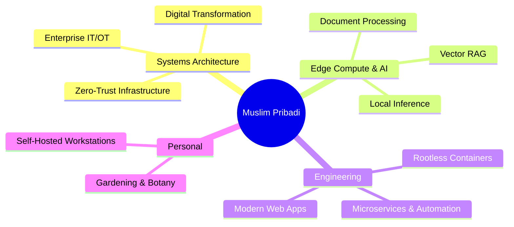

# MUSLIM PRIBADI

*Architecting digital systems by day • Tending plants & soil by night*

---

### 🪴 THE GARDEN OF CRAFT

  > *"When I'm away from the keyboard, you'll find me out in the garden."*

---

### ─── ☁️ DOMAINS & TECHNOLOGIES ───

---

  <code>01000001 01010010 01000011 01001000 01001001 01010100 01000101 01000011 01010100</code>

